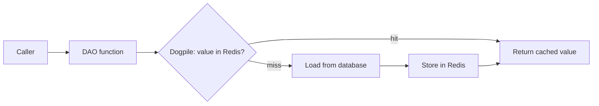
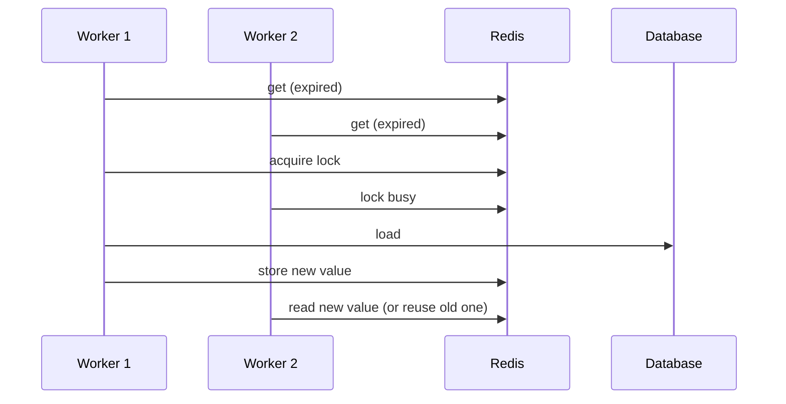
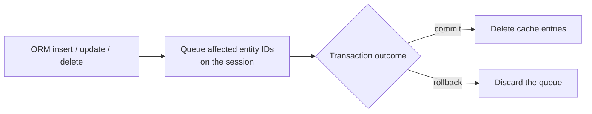
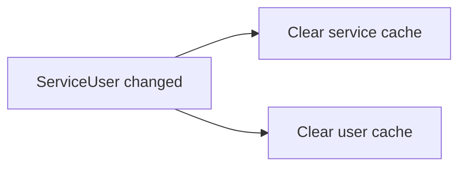

# Dogpile cache architecture overview

This guide explains why we cache with [Dogpile](https://dogpilecache.sqlalchemy.org/) and how the pieces fit together. For code examples and how to add a new cached function, see the usage guide.

## Why we cache

Services, users, templates and notifications are read far more often than they change. Reading each one from the database, and serializing it again, on every request is wasteful. Dogpile keeps a copy in Redis so repeated reads skip the database.

The database is always the source of truth. The cache is a shortcut that we can lose at any time without losing data.

Dogpile is separate from the older caching helpers in the codebase. This guide covers Dogpile only.

## How a read works

A caller asks a DAO function for data. The DAO asks Dogpile. Dogpile looks in Redis and only calls the database when the value is missing or too old.



The cache stores plain dictionaries (as JSON), not ORM objects, because ORM objects cannot be shared between processes without complex cache-to-session rehydration and synchronization machinery. DAO functions that opt in, via the `use_dogpile` parameter, always return a dictionary when asked for Dogpile data. This holds true even when `FF_USE_DOGPILE_CACHING` is off or Redis is unavailable, in which case they read the database and return the same dictionary shape. Calls that do not opt in keep returning ORM objects.

## What we store

Keys are grouped by entity so that every cached variant of that entity can be removed together. For example:

```text
service:<service_id>:dao_fetch_service_by_id:<args>
```

Each namespace picks one of two key styles and one of two regions. Two terms matter here. *Freshness* is how long a value is used before Dogpile treats it as expired. *Redis lifetime* is how long Redis physically keeps it.

| Namespace | Key style | Freshness | Redis lifetime | Removal |
|---|---|---|---|---|
| service, user, template | `<namespace>:<id>:<fn>:<args>` | 600 s | 600 s | Prefix scan on `<namespace>:<id>:` |
| notification | `<namespace>:<id>` | 60 s | 120 s | Exact-key `UNLINK` |

Prefix keys allow many cached functions and argument combinations per entity, at the cost of a Redis `SCAN` to remove them. Since notifications change often, they use one function per entity and one exact key. That makes removal a cheap batched delete with no scan.

## What happens when requests arrive together

When a value is missing or expired, many workers may ask for it at the same moment. Dogpile uses a Redis lock to help ensure one worker regenerates a given key at a time.

> Caveat:
> The lock times out after 5 seconds. This reduces duplicate database work. It does not guarantee that a value is regenerated exactly once.



If there is no value at all, the other workers wait for the first one. For notifications, Redis keeps a value for one extra freshness window, so waiting workers can reuse the expired value instead of waiting. The default region does not keep expired values, so this does not apply to services, users or templates.


## How writes clear old data

*Invalidation* means removing cached data so the next read loads fresh data. We do it automatically from ORM changes.



Deleting only after commit means a rolled-back change never clears good data.

A registry maps each model to the cache entries it affects. Some models affect more than their own entity. For example, a membership change (`ServiceUser`) clears both the service and the user cache.



Notification inserts are skipped, because a new notification cannot be cached yet. Bulk writes bypass normal ORM change tracking, so they must pass the affected IDs explicitly. The usage guide shows how.

## 6. Limits and failures

- If Redis cannot be read, opted-in DAO functions fall back to the database.
- Invalidation is best effort. If it fails, the error is logged and the write still succeeds. Stale data then lasts until the freshness window ends.
- A read that races with a write can briefly re-cache old data. There is no strict consistency.
- Short freshness on notifications bounds how long any missed invalidation can matter.

Code map:

- [app/caching.py](../../caching.py): namespaces, key generation, regions, the `cache_on_arguments` decorator and deletion helpers.
- [app/cache/cache_events.py](../cache_events.py): ORM event hooks that queue invalidations and run them after commit.
- [app/cache/cache_invalidation_registry.py](../cache_invalidation_registry.py): which model changes clear which namespaces.

For function-level detail (key generation, serialization, the invalidation pipeline and debugging), see [dogpile-cache-internals.md](./dogpile-cache-internals.md).
