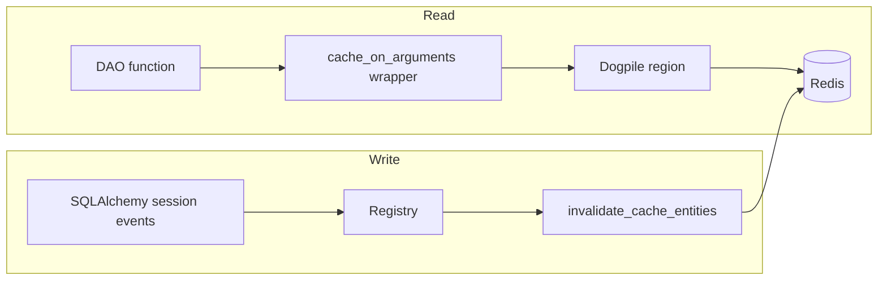
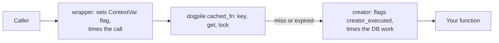
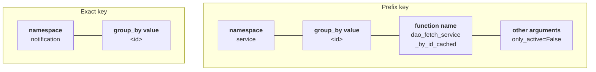
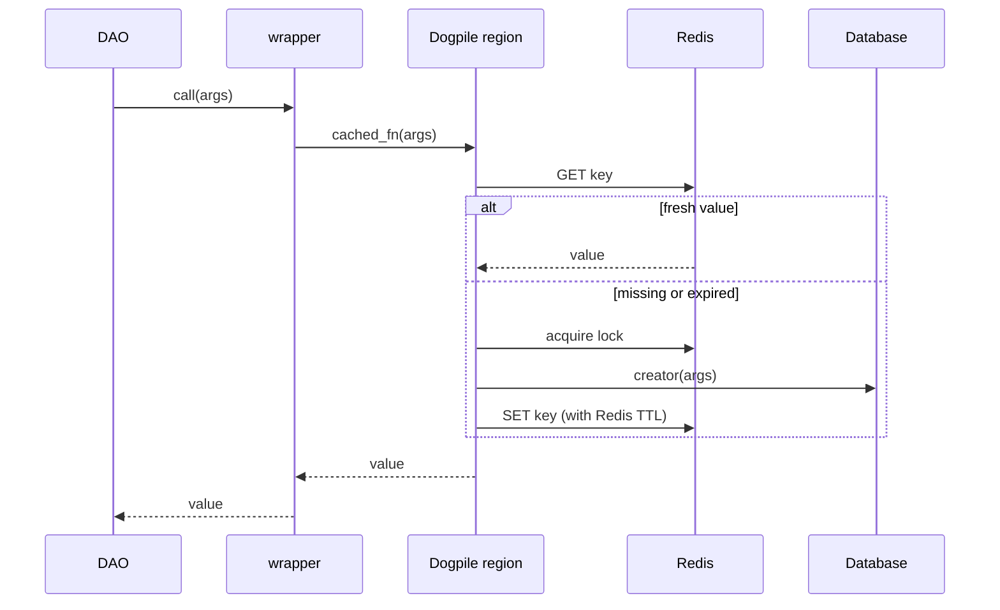
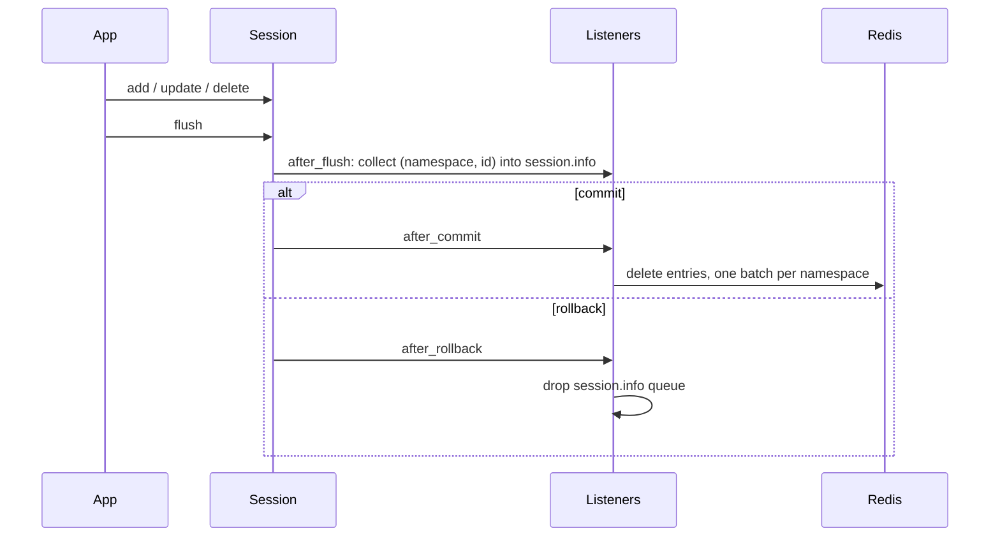
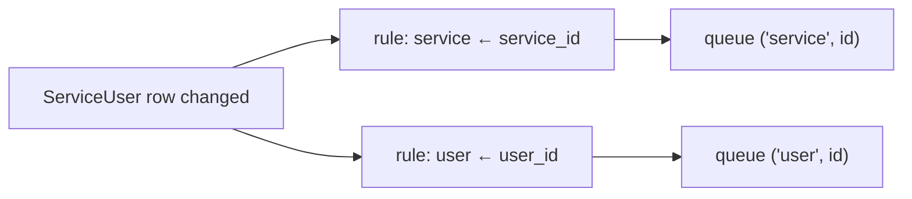

# Dogpile cache internals

How the Dogpile cache works at the code level. Read the [architecture overview](./dogpile-cache-architecture-overview.md) first for the concepts. For how to add or call cached functions, see the [usage guide](./dogpile-cache-usage-guide.md).

Where behaviour comes from the dogpile.cache library rather than our code, this guide says so.

## Component map

| Part | File | Job |
|---|---|---|
| Regions, namespaces, decorator, keys, deletion | [app/caching.py](../../caching.py) | Everything on the read path, plus deleting Redis keys |
| ORM event hooks | [app/cache/cache_events.py](../cache_events.py) | Collect affected IDs during a transaction and delete after commit |
| Registry | [app/cache/cache_invalidation_registry.py](../cache_invalidation_registry.py) | Maps ORM models to the namespace and ID attribute to clear |
| Bulk DML helper | [app/cache/cache_dml.py](../cache_dml.py) | Attaches affected IDs to a bulk statement |

Both halves are set up at app start in [app/__init__.py](../../__init__.py): `init_dogpile_cache(application)` configures the regions, and `register_cache_orm_events()` attaches the session listeners.

## Regions and the Redis backend

There are two module-level regions in `app/caching.py`: `dogpile_region` (default) and `short_lived_region`. Both use our key generator and our JSON serializer pair.

`init_dogpile_cache` configures them through `_configure_region` with the same `REDIS_URL`. The backend arguments are:

| Argument | Value | Effect |
|---|---|---|
| `expiration_time` | 600 s default, 60 s short-lived | Freshness: when dogpile considers a value expired |
| `redis_expiration_time` | 600 s default, 2 × freshness short-lived | Redis TTL: when Redis deletes the key |
| `distributed_lock` | `True` | Regeneration lock is held in Redis, so it works across workers |
| `thread_local_lock` | `False` | The lock is not tied to the creating thread |
| `lock_timeout` | `5` | Lock auto-expires after 5 seconds |

Because the short-lived region keeps Redis values twice as long as its freshness window, an expired notification value can still be found in Redis. The library can hand that old value to waiting callers while one caller regenerates it. This stale-serve behaviour is dogpile's; our code only sets the lifetimes.

Two helpers matter for tests and deletion:

- `_get_region(name)` looks the region up at call time, so tests can patch the module-level regions.
- `_get_redis_client_from_region(region)` returns the backend's raw Redis client (`writer_client` or `client`). It raises `RuntimeError` if the region is not configured yet or is not a Redis backend. Deletion uses this client directly because dogpile has no delete-by-pattern functionality built in, so we had to build it ourself.

## Namespaces and the decorator

`CacheNamespace` has two fields: `key_strategy` (`prefix` or `exact`) and `region` (`default` or `short_lived`). `CACHE_NAMESPACES` lists the exceptions. Today only `notification` is listed (exact keys, short-lived region). Anything else, including service, user and template, gets `CacheNamespace()`: prefix keys, default region. `get_cache_namespace` does that lookup.

`cache_on_arguments(namespace=, group_by=, should_cache_fn=None)` runs these checks when the module is imported, so mistakes fail early:

- `group_by` must be a parameter of the function, otherwise `TypeError`.
- An exact namespace requires the function to take only the `group_by` parameter, otherwise `TypeError`.

It also stamps `fn.__cache_group__ = (namespace, group_by)`, which the key generator uses to compose the cache keys.

Two wrappers sit around your function:

**Some terms** 
> **Creator** - The DAO function performing the actual DB query
>
> **Wrapper** - The `cache_on_arguments` 

- `creator` marks `creator_executed = True` in a per-function `ContextVar` and emits the `cache.creator.<namespace>.<success|error>.duration` metrics via StatsD.
- `wrapper` sets up that `ContextVar`, calls dogpile, and afterwards labels the call `regenerated` if the creator ran or `reused` if not. On an exception the label is `error`. It emits `cache.access.<namespace>.<outcome>` and its `.duration`.

So "reused" means "creator did not run in this call". It includes both a fresh hit and a stale value served while another worker regenerates.

## Key generation

`cache_key_generator(namespace, fn)` is dogpile's `function_key_generator` hook. For each call it:

1. Binds the arguments to the signature with `_bind_args`, which applies defaults. `f(x)` and `f(x, only_active=False)` therefore produce the same key.
2. Builds the key from the bound arguments.

| Style | Format | Notes |
|---|---|---|
| Prefix | `<ns>:<id>:<fn>:<name=value\|name=value>` | The `group_by` argument becomes `<id>`; remaining arguments form the fingerprint |
| Exact | `<ns>:<id>` via `exact_cache_key` | No function name or arguments |
| Ungrouped | `<ns>:ungrouped:none:<fn>:<all args>` | Fallback if a function has no group info |

`_serialize_key_value` turns each argument into a stable string:

- UUIDs and UUID-shaped strings are normalized to the canonical string, so a `UUID` object and its string give the same key.
- `None` becomes `"None"`. `bool`, `int`, `float` and `str` use `str()`.
- Tuples and lists keep their order. Sets are sorted. Dicts use sorted-key compact JSON, falling back to a sorted `repr` of the items when they can't be JSON-encoded.
- Anything else uses `repr()`, so objects without a stable `repr` make unstable keys.

Prefix keys are built so that `<ns>:<id>:` is a prefix shared by every cached variant of one entity. That prefix is what deletion scans for.

## Value serialization

Values are stored as compact UTF-8 JSON:

- `_json_cache_serializer` uses `json.dumps(value, default=str, separators=(",", ":"))`. Key order is kept, so cached payloads match uncached responses byte for byte.
- `_json_cache_deserializer` accepts `bytes` or `str` and calls `json.loads`.

Consequences for cached functions: anything not natively JSON (UUIDs, datetimes, `Decimal`) goes through `str()` and comes back as a string. Tuples come back as lists. Return types should be plain dicts and lists whose values are already JSON-safe.

`should_cache_fn` is passed straight to dogpile. When it returns false for a freshly created value, dogpile returns the value without storing it. The notification snapshot uses `lambda snapshot: snapshot is not None` so "not found" is never cached.

## Read path in detail

The lock, waiting and stale-reuse decisions inside the region belong to dogpile. Our code configures them through the region arguments in section 2.

On top of this, the opted-in DAOs add their own gate. `dao_fetch_service_by_id` in [services_dao.py](../../dao/services_dao.py) works like this:

1. If `use_dogpile` is true and `FF_USE_DOGPILE_CACHING` is exactly `True`, call the cached function.
2. If that raises `RedisError`, log a warning and continue.
3. Otherwise read the database. With `use_dogpile`, dump the ORM object to a dictionary so the return shape stays the same.

Only `RedisError` is caught. Errors from the creator itself, such as `NoResultFound`, propagate to the caller.

## Invalidation pipeline

Invalidation hooks into SQLAlchemy `Session` events, registered once per process by `register_cache_orm_events` (guarded by a lock, so repeat calls are safe).

| Event | Listener | What it does |
|---|---|---|
| `after_flush` | `_collect_cache_invalidations` | Looks at new, dirty and deleted instances. For each registry rule that matches the instance's model, queues `(namespace, str(id))`. Inserts are skipped when the rule has `invalidate_on_insert=False`. |
| `do_orm_execute` | `_intercept_bulk_operations` | For bulk update or delete statements carrying the `cache_invalidating_dml` option, queues the IDs given. |
| `after_commit` | `_invalidate_cache_after_commit` | Pops the queue, groups IDs by namespace, calls `invalidate_cache_entities` once per namespace. Exceptions are logged per namespace, so one failure does not block the others or the commit. |
| `after_rollback` | `_clear_cache_invalidations_after_rollback` | Drops the queue. |

The queue is a `set` in `session.info["cache_invalidations_to_run"]`, so many changes to one entity produce one deletion.

Explicit paths exist for writes the ORM cannot track:

- `cache_invalidating_dml(statement, **entity_ids)` stores the IDs as an execution option on the statement. Only bulk update and delete statements are intercepted.
- `queue_cache_invalidations(session, Model, **entity_ids)` queues directly. It does nothing if the commit listener is not registered.

Both go through `_queue_entity_invalidations`, which raises `ValueError` if the IDs for any attribute the model's rules need are missing. This catches, for example, a `ServiceUser` bulk write that gave `service_id` but not `user_id`, which would leave the user cache stale.

How the registry resolves a change:

## Deletion mechanics

`invalidate_cache_entities(namespace, entity_ids)` chooses the method from the namespace's key strategy.

**Prefix namespaces** call `invalidate_group_keys` for each unique ID:

- It runs `SCAN` with `MATCH <ns>:<id>:*` and `COUNT 500`, following the cursor until it returns to 0.
- Each batch of found keys is removed with `DELETE`.
- It returns the number deleted, and emits `cache.invalidation.<ns>.<success|error>` plus `.duration`, `.scans`, `.matched` and `.deleted` metrics via statsD.

**Exact namespaces** call `_unlink_exact_keys`:

- It builds `<ns>:<id>` keys, drops duplicates, and removes them in batches of 500 with `UNLINK`, which frees memory in the background.
- It does no scanning and logs one `cache.invalidate_exact_keys` line with batch, key and deleted counts.

**Trade-offs: Prefix vs Exact invalidation** 

*Prefix namespace* invalidation utilizes `SCAN` which walks the Redis keyspace for every ID, so cost grows with total keys and not just matching ones. That is acceptable for low-churn entities. 

*Exact namespace* invalidation uses `UNLINK`, the cost depends only on the number of keys given, and is more cost appropriate for high-churn entities, which is why notifications currently use it.

## Observability map

| Signal | Emitted by |
|---|---|
| `cache.access.<ns>.<reused\|regenerated\|error>` and `.duration` | `wrapper` in `cache_on_arguments` |
| `cache.creator.<ns>.<success\|error>.duration` | `creator` in `cache_on_arguments` |
| `cache.collect_invalidations.<success\|error>`, `.duration`, `.instances`, `.invalidations` | `_collect_cache_invalidations` |
| `cache.invalidation.<ns>.*` | `invalidate_group_keys` (prefix only) |
| `cache.invalidate_exact_keys …` log line | `_unlink_exact_keys` |
| "Failed to invalidate cache" log with `cache_namespace` and `cache_entity_count` | `_invalidate_cache_after_commit` |

Exact-key deletion emits a log line and no `cache.invalidation.*` metrics. See the usage guide for the dashboard file.

## Failure modes and gotchas

| Symptom | Likely cause | Where to look |
|---|---|---|
| Stale data after a bulk write | Write bypassed the ORM and no IDs were declared | `cache_invalidating_dml` / `queue_cache_invalidations` in the write path |
| `ValueError: Missing cache invalidation entity IDs` | Explicit invalidation omitted an attribute a registry rule needs | Rules for that model in the registry |
| `TypeError` at import | `group_by` is not a parameter, or an exact namespace function takes extra arguments | Decorator checks in `cache_on_arguments` |
| Same data cached under several keys | Argument types render differently, or a value with an unstable `repr` | `_serialize_key_value` |
| UUID or date field is a string after a cache hit | JSON round trip | Serializer pair; convert in the caller |
| Cache never hits for a call | `should_cache_fn` rejected the value, or the flag is off | DAO gate and `should_cache_fn` |
| Invalidation did not run | Commit listener not registered, or deletion raised and was logged | `register_cache_orm_events`, "Failed to invalidate cache" logs |
| Brief stale value right after a write | A read raced the write and re-cached old data before the delete ran | Expected; see the architecture overview's limits |

Other details worth knowing:

- `session.dirty` can include instances with no real column change, so some deletions are unnecessary. That is harmless but visible in the metrics.
- Deletion happens after commit and is not retried. A Redis outage at that moment leaves stale entries until their freshness window ends.
- The lock timeout is 5 seconds. A creator slower than that can run in more than one worker.

## Where to make changes

| To change | Edit |
|---|---|
| Namespace key style or region | `CACHE_NAMESPACES` in [app/caching.py](../../caching.py) |
| Key format or argument serialization | `cache_key_generator`, `_serialize_key_value` |
| Freshness or Redis lifetime | `init_dogpile_cache`, `DOGPILE_*` config |
| Which changes clear which cache | [cache_invalidation_registry.py](../cache_invalidation_registry.py) |
| When or how invalidation runs | [cache_events.py](../cache_events.py) |
| Deletion method | `invalidate_cache_entities`, `invalidate_group_keys`, `_unlink_exact_keys` |
